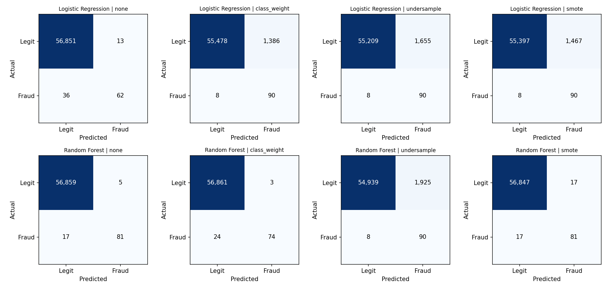
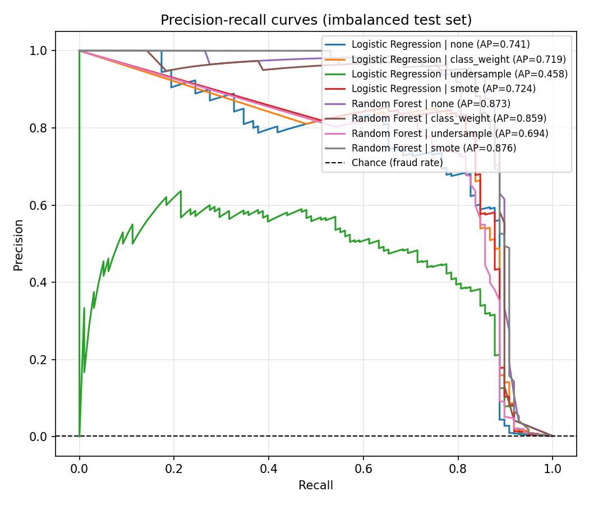
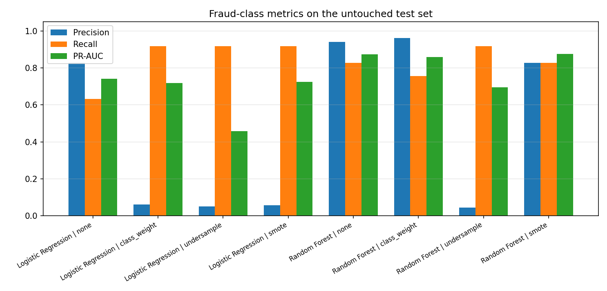

# Secure Pay Vision

Credit card fraud detection on a highly imbalanced dataset, comparing **Logistic Regression** and **Random Forest** under four imbalance-handling strategies (none, class weights, undersampling, SMOTE).

## Why this project is evaluated the way it is

Only 492 of 284,807 transactions (about 0.17%) are fraud. A model that labels *everything* as legitimate scores about **99.83% accuracy** while catching zero fraud, so accuracy alone says almost nothing here. This repo therefore:

- splits the **original, imbalanced** data into train/test once (stratified), and **never resamples the test set**;
- applies undersampling / SMOTE to the **training data only**;
- reports **precision, recall, F1, PR-AUC, ROC-AUC and confusion matrices** (frauds caught vs. missed), plus the always-predict-legit accuracy for reference.

## Dataset

Kaggle: [Credit Card Fraud Detection (ULB)](https://www.kaggle.com/datasets/mlg-ulb/creditcardfraud). 284,807 transactions from two days in September 2013; features `V1`-`V28` are PCA components, plus `Time`, `Amount` and the label `Class` (1 = fraud).

The data is **not included** in this repo. Download `creditcard.csv` and place it at `data/creditcard.csv` (or pass `--data /path/to/creditcard.csv`, or set the `CREDITCARD_CSV` environment variable). Check the Kaggle page for the dataset's license terms.

## Setup

```bash
git clone https://github.com/<your-username>/Secure-Pay-Vision.git
cd Secure-Pay-Vision
python -m venv .venv && source .venv/bin/activate    # Windows: .venv\Scripts\activate
pip install -r requirements.txt
```

## Usage

```bash
# Run all experiments (2 models x 4 strategies), write metrics + plots to results/
python -m src.train --data data/creditcard.csv

# Faster run
python -m src.train --models rf --strategies class_weight undersample --n-estimators 100

# Score new transactions in batch with the best saved model (offline, not real-time)
python -m src.predict --input new_transactions.csv --output results/scored.csv

# Tests (synthetic data, no download needed)
pytest
```

Outputs in `results/`: `metrics.csv`, `metrics.md`, `confusion_matrix.png`, `roc_curve.png`, `pr_curve.png`, `model_comparison.png`. The best run by PR-AUC is saved to `models/best_model.joblib` (git-ignored). The interactive walkthrough is in `notebooks/secure_pay_vision.ipynb`.

## Results

Single stratified 80/20 split (seed 42), default 0.5 threshold. The untouched test set has **56,962 transactions, 98 of them fraud (0.17%)**; always predicting "legit" would score 0.9983 accuracy.

| run | accuracy | precision | recall | f1 | roc_auc | pr_auc | tp | fn | fp |
|---|---|---|---|---|---|---|---|---|---|
| Logistic Regression \| none | 0.9991 | 0.8267 | 0.6327 | 0.7168 | 0.9605 | 0.7414 | 62 | 36 | 13 |
| Logistic Regression \| class_weight | 0.9755 | 0.0610 | 0.9184 | 0.1144 | 0.9721 | 0.7190 | 90 | 8 | 1386 |
| Logistic Regression \| undersample | 0.9708 | 0.0516 | 0.9184 | 0.0977 | 0.9752 | 0.4578 | 90 | 8 | 1655 |
| Logistic Regression \| smote | 0.9741 | 0.0578 | 0.9184 | 0.1088 | 0.9708 | 0.7245 | 90 | 8 | 1467 |
| Random Forest \| none | 0.9996 | 0.9419 | 0.8265 | 0.8804 | 0.9623 | 0.8730 | 81 | 17 | 5 |
| Random Forest \| class_weight | 0.9995 | 0.9610 | 0.7551 | 0.8457 | 0.9572 | 0.8589 | 74 | 24 | 3 |
| Random Forest \| undersample | 0.9661 | 0.0447 | 0.9184 | 0.0852 | 0.9749 | 0.6942 | 90 | 8 | 1925 |
| Random Forest \| smote | 0.9994 | 0.8265 | 0.8265 | 0.8265 | 0.9685 | 0.8760 | 81 | 17 | 17 |

(`tp`/`fn` = frauds caught/missed out of 98, `fp` = legitimate transactions wrongly flagged. Full table: [`results/metrics.md`](results/metrics.md).)





**What the results show**

- **Random Forest without resampling is the strongest all-round model**: it catches 81 of 98 frauds with only 5 false alarms (precision 0.94, F1 0.88, PR-AUC 0.87). Random Forest + SMOTE ties it on PR-AUC (0.876 vs 0.873) but raises false alarms from 5 to 17, so SMOTE gives no clear benefit here.
- **Logistic Regression is clearly weaker as a plain baseline**: it catches 62 of 98 frauds (recall 0.63, PR-AUC 0.74).
- **Class weights, undersampling and SMOTE raise recall to 0.92 (90 of 98 caught) for Logistic Regression, but at a heavy price**: roughly 1,400-1,650 false alarms, so precision falls to about 5-6%. Undersampling Random Forest has the same effect (1,925 false alarms).
- **Undersampling is the worst strategy by PR-AUC** (0.46 for Logistic Regression, 0.69 for Random Forest), even though those models have the *highest* ROC-AUC (about 0.975). ROC-AUC is misleading on data this imbalanced, which is why PR-AUC and the confusion matrices are used for the comparison.
- **Which model is "best" depends on cost.** If missing a fraud is far more expensive than reviewing a false alarm, a high-recall configuration may be preferred; if analyst time is scarce, Random Forest without resampling is better.

*Caveat: with only 98 test frauds and one split, small differences (for example Random Forest none vs SMOTE) are within noise. Cross-validation would be needed to rank them with confidence.*

## Limitations

- Single train/test split and a fixed 0.5 threshold; no cross-validation or threshold tuning yet.
- Features are PCA-anonymised, so results say little about real-world feature engineering or interpretability.
- The data covers only two days in 2013 and ignores concept drift, so retraining behaviour is untested.
- `src/predict.py` is **offline batch scoring**. There is no real-time/streaming service or deployment.

## Repository structure

```
src/            data_loader.py, models.py, evaluate.py, train.py, predict.py
notebooks/      secure_pay_vision.ipynb   (consolidated walkthrough)
tests/          synthetic-data smoke tests
results/        generated metrics and plots
docs/           project_overview.md
data/           put creditcard.csv here (git-ignored)
```

